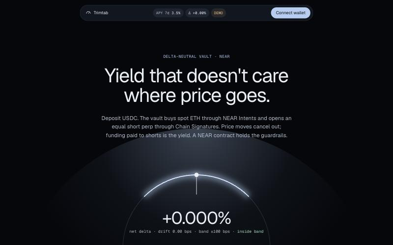

# Trimtab

| Backtest, 12 months (not live) | Value |
|---|---|
| Net APR after fees | 3.90% |
| APR, last 7 days of the window | 3.51% |
| Max hedge drift | 0.000% (legs assumed to fill together; see note) |
| Max drawdown | 0.26% |
| Final net delta | 0.000% |
| Vault account | not deployed yet: no mainnet or testnet account was provided |

*Backtest = real hourly ETH funding from the perp venue and real hourly ETH spot prices, 1 Nov 2025 to 31 Oct 2026 (8,759 hours), run through the keeper's own rebalance code with simulated execution and fees. It is not a record of live trading. Hedge drift is zero in the backtest because both legs are assumed to fill in the same hour at equal size; live drift comes from 1Click settlement time (about 20 s per quote) and the venue lot size, and the contract caps it at ±100 bps (I2). On $10,000 the year earned $478.71 of funding, paid $104.36 in fees and lost $7.18 to basis. Regenerate it with `cargo run -p keeper -- backtest`; the test `readme_matches_backtest` fails if this table drifts from the code.*

**What it is.** A USDC vault on NEAR that holds spot ETH bought through NEAR Intents and an equal short perp signed through NEAR Chain Signatures, so price moves cancel and the funding paid to shorts is the yield. A NEAR contract enforces the hedge and risk limits on every trade.

**Problem.** Perp funding paid shorts 6.31% a year on average over the window, but 16.2% of hours went the other way, and earning it today means trusting a custodian, or running two venues by hand with no hard limits on the bot that trades them.

## Try it (do X → see Y)

1. `cargo leptos watch` → open http://localhost:3000 → the hedge gauge and the floating pill show live net delta and APY. A `DEMO` chip marks the simulated vault.
2. In **Deposit**, type `alice.near` and `250`, press **Deposit to demo vault** → the card reports minted shares, computed by the contract's own share math (`crates/vault-contract/src/math.rs`).
3. Press **Connect wallet** → NEAR Wallet Selector 10 opens (Meteor, MyNearWallet, HOT, Intear). The connected account fills the deposit field.
4. `curl localhost:3000/api/state` → the same numbers as JSON, with `"label": "DEMO: …"`.
5. `cargo run -p keeper -- backtest` → the 12-month table above plus month-by-month funding and vault returns.
6. `cargo run -p keeper -- quote --usdc 25` → a real 1Click `dry: true` quote from USDC to bridged ETH. Nothing moves.



| Vault panels | 375 px |
|---|---|
|  |  |

## Mechanism
```
deposit USDC ─▶ vault contract ─▶ spot leg (Intents 1Click: USDC → eth.bridge.near, held by the contract)
                         └──────▶ short leg (1Click: USDC → Arbitrum USDC at the vault's derived address,
                                   then Chain Signatures signs the venue order the contract hashed)
keeper (Axum) rebalances when |delta| > band or perp leverage leaves 2x–4.5x
```
- Target split is 75% spot / 25% margin: a 3x short that matches the spot size.
- The contract rebuilds every perp order's msgpack payload and EIP-712 digest itself (`src/hl.rs`), then sends only that digest to `v1.signer`. The keeper proposes the order fields; it never supplies a hash.
- The contract reads the spot leg from the token (`sync_spot` → `ft_balance_of`), so the spot leg is never taken on the keeper's word.
- Margin can only move between the venue bridge and the vault's own derived address. Both destinations are fixed in config (`src/evm.rs`).

## Invariants (enforced in the contract)
| # | Invariant | Where in code | Test |
|---|---|---|---|
| I1 | Shares mint and burn at NAV/share, rounding in the vault's favour; virtual shares block the donation attack | `math.rs`, `ft_on_transfer`, `withdraw`, `claim` | `i1_shares_deposit_and_withdraw_at_nav`, `i1_shares_queued_withdrawal_is_claimable_after_refill`, `i1_shares_rejects_wrong_token_and_dust`, `math::tests::donation_attack_is_unprofitable` |
| I2 | A perp order is signed only if drift stays inside the hedge band or moves toward neutral | `check_hedge`, `request_perp_order`, `request_paired_reduce` | `i2_hedge_band_signs_valid_order_through_mpc`, `i2_hedge_band_refuses_order_that_breaks_band`, `i2_paired_reduce_keeps_legs_matched`, `i2_failed_signature_rolls_back_position` |
| I3 | NAV/share more than 5% below its high-water mark switches the vault to unwind-only | `report` | `i3_drawdown_switches_vault_to_unwind_only` |
| I4 | Only allowlisted keepers allocate, report or request signatures; only the owner edits the list | `assert_keeper`, `add_keeper` | `i4_keeper_allowlist_guards_every_risk_method` |
| I5 | Pause stops new risk; unwind allows only reduce-only trades; withdrawals never stop | `pause`, `emergency_unwind`, `resume` | `i5_pause_stops_new_risk_but_not_withdrawals` |
| I6 | Per-epoch caps on rebalance count, traded notional and USDC moved out | `roll_epoch`, `check_turnover`, `allocate` | `i6_epoch_limits_cap_rebalances_and_allocation`, `i6_epoch_turnover_cap` |
| I7 | One keeper report cannot move NAV by more than 3% | `report` | `i7_nav_report_cannot_jump` |
| I8 | Order limit price must be within 1% of the last mark | `request_perp_order` | `i8_price_sanity_refuses_off_market_limit` |

The sandbox tests (`crates/vault-contract/tests/sandbox.rs`) run the real wasm on a local near-workspaces sandbox with two NEP-141 tokens and a stand-in MPC signer (`crates/sandbox-fixtures`). The stand-in uses the network's key derivation with a public test key, so the tests check that each signature recovers to the vault's derived key.

## Run it (3 commands)
```
cargo install cargo-leptos cargo-nextest cargo-near   # plus: rustup target add wasm32-unknown-unknown
cargo nextest run --workspace                          # → 84 passed (35 contract unit, 16 sandbox, 32 keeper, 1 web)
cargo leptos watch                                     # → open :3000, see the gauge
```
No keys and no `.env` are needed. `.env.example` lists the optional settings. The first `cargo nextest` run builds both contracts with `cargo near` and downloads the near-workspaces sandbox binary, so it needs network once.

## Risks
| Risk | Mitigation |
|---|---|
| Funding turns negative for long stretches (16.2% of hours in the window) | Shown in the backtest and the monthly bars; the owner can `emergency_unwind`; the 5% drawdown stop trips automatically |
| A compromised keeper | It can only trade inside I2–I8. It cannot choose where margin goes, and every hash it gets signed is built by the contract |
| A keeper sends `allocate` USDC to a wrong 1Click deposit address | Destinations must be 64-hex implicit accounts and are capped per epoch (I6). Remaining trust: the keeper picks the quote. Next step: deposit through `intents.near` with contract-signed intents |
| Keeper misreports perp value | I7 caps each report's NAV move; the spot leg is read on chain; the drawdown stop works on reported NAV |
| Perp venue or bridge failure | One venue today behind the `PerpVenue` trait (`crates/keeper/src/venue.rs`); leverage target 3x; worst margin ratio in the backtest 22.2% vs 2% maintenance |
| Rapid price spike before a rebalance | Backtest max leverage 4.50x (the rebalance trigger); paired reduce shrinks both legs in one transaction |
| Smart-contract bugs | Unaudited hackathon code. The mainnet path is capped at 100 USD and needs an explicit confirmation phrase (`crates/keeper/src/live.rs`) |

## NEAR components
| Component | Used for | Transaction |
|---|---|---|
| Rust contract (near-sdk 5.30, cargo-near 0.23) | Shares, guardrails, order hashing | Sandbox only so far; `scripts/deploy-testnet.sh` deploys once an account is provided |
| Chain Signatures (`v1.signer`) | Signs perp orders, the bridge deposit and margin withdrawals for the vault's derived EVM key | Sandbox: stand-in signer; live: none yet |
| NEAR Intents 1Click | USDC → spot ETH on NEAR; USDC → settlement-chain USDC for margin | `dry: true` quotes only (`/api/quote`) |
| NEP-141 USDC (`17208628…a1`) and `eth.bridge.near` | Deposit asset and spot leg | — |
| NEAR Wallet Selector 10 | Connect wallet (`crates/web/public/wallet.js`) | — |

## Mainnet path (opt-in, not run)
`trimtab-keeper tick` refuses mainnet unless `TRIMTAB_MAX_NOTIONAL_USD` is at most 100 and `TRIMTAB_MAINNET_CONFIRM` exactly matches `I accept real-money risk up to <cap> USD`. It prints the near-cli-rs commands unless `TRIMTAB_EXECUTE=1`. Keys stay in the system keychain; the keeper never holds a NEAR private key.

## Repo
`crates/vault-contract` (contract), `crates/keeper` (Axum keeper, backtest, demo, venue and 1Click clients), `crates/web` (Leptos SSR, hand-written CSS), `crates/sandbox-fixtures` (test-only contract), `data/` (fetched with `cargo run -p keeper -- fetch-history`). Hosting: `Dockerfile` + `fly.toml` (Fly.io). License: MIT.
