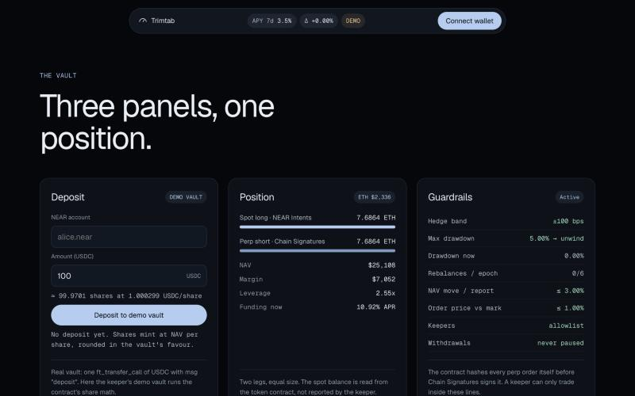
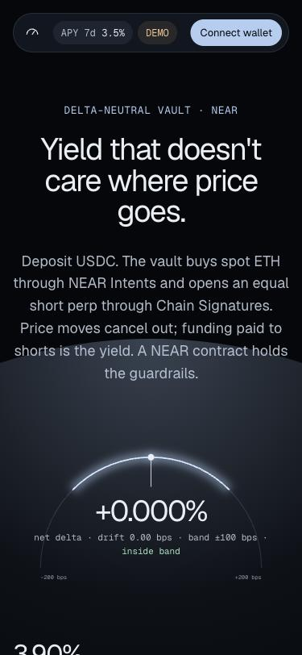

# Trimtab

*Built at NEAR HACKATHON (Nov 1–14, 2026) · Track: Unstoppable DeFi (`defi`)*

A savings vault for dollars that earns what perp traders pay to stay long, while ETH's price cancels out. A NEAR contract holds the limits on the bot that trades it.

## Try it in 60 seconds

No keys, no `.env`, no wallet needed.

```bash
cargo install cargo-leptos cargo-nextest cargo-near && rustup target add wasm32-unknown-unknown
```
```bash
cargo leptos watch
```
1. Open http://localhost:3000 → the hedge gauge and the floating pill show the vault's net delta and APY. A `DEMO` chip marks the simulated vault.
2. **Deposit** card: type `alice.near` and `250`, press **Deposit to demo vault** → minted shares, computed by the contract's own share math (`crates/vault-contract/src/math.rs`).
3. Scroll to the **daily receipt** → what $10,000 earned that day vs US Treasury bills, with the source.
4. **Connect wallet** → NEAR Wallet Selector 10 (Meteor, MyNearWallet, HOT, Intear).
5. `cargo nextest run --workspace` → 93 tests, including **19 of 19 attacks refused** on a local NEAR sandbox ([docs/break-it.md](docs/break-it.md)).

| Backtest, 12 months (not live) | Value |
|---|---|
| Net APR after fees | 3.90% |
| APR, last 7 days of the window | 3.51% |
| Max hedge drift | 0.000% (legs assumed to fill together; see note) |
| Max drawdown | 0.26% |
| Final net delta | 0.000% |
| vs US T-bills, same $10,000, same year | $367.17 vs $385.41: ahead on 197 of 365 days, 7 of 12 months, **behind over the year** |
| Vault account | not deployed yet: no mainnet or testnet account was provided |

*Backtest = real hourly ETH funding from the perp venue and real hourly ETH spot prices, 1 Nov 2025 to 31 Oct 2026 (8,759 hours), run through the keeper's own rebalance code with simulated execution and fees. It is not a record of live trading. Hedge drift is zero in the backtest because both legs are assumed to fill in the same hour at equal size; live drift comes from 1Click settlement time (about 20 s per quote) and the venue lot size, and the contract caps it at ±100 bps (I2). On $10,000 the year earned $478.71 of funding, paid $104.36 in fees and lost $7.18 to basis. Regenerate with `cargo run -p keeper -- backtest`; the test `readme_matches_backtest` fails if this table drifts from the code.*

**What it is.** A USDC vault on NEAR that holds spot ETH bought through NEAR Intents and an equal short perp signed through NEAR Chain Signatures, so price moves cancel and the funding paid to shorts is the yield. A NEAR contract enforces the hedge and risk limits on every trade.

**Problem, measured.** Over the 8,759 hours above, ETH perp funding paid shorts 6.31% a year on average, but shorts paid in 16.2% of hours; monthly averages ran from −0.39% to 10.19%. Collecting it today means trusting a custodian, or running two venues by hand with no hard limits on the bot that trades them. Net of fees it roughly matched T-bills in this window; the point of Trimtab is that it does so on chain, from NEAR, with every limit enforced by a contract anyone can read.


| Vault panels | 375 px |
|---|---|
|  |  |

## Where it stands

| | What | Evidence |
|---|---|---|
| ✅ | Vault contract: shares, hedge band, drawdown stop, keeper allowlist, pause/unwind, epoch caps, frozen payout destinations | [`lib.rs`](crates/vault-contract/src/lib.rs), 37 unit tests, 17 sandbox tests |
| ✅ | 19 of 19 attacks refused on a local NEAR sandbox | [`docs/break-it.md`](docs/break-it.md), test `break_it_every_attack_is_refused` |
| ✅ | Perp orders hashed inside the contract, byte-exact with the venue's published test vectors | `hl::tests::connection_id_matches_reference_vector`, `mpc::tests::venue_order_signature_matches_reference_vector` |
| ✅ | Chain Signatures path end to end on the sandbox, with a stand-in signer using the network's key derivation | `i2_hedge_band_signs_valid_order_through_mpc` |
| ✅ | 12-month backtest on real hourly data; daily receipt vs US T-bills from Treasury data | [`backtest.rs`](crates/keeper/src/backtest.rs), [`receipt.rs`](crates/keeper/src/receipt.rs), [`data/`](data) |
| ✅ | Live reads: 1Click `dry: true` quotes and the venue's funding rate | `cargo run -p keeper -- quote`, `GET /api/market` with `TRIMTAB_ONLINE=1` |
| ✅ | MCP server for AI agents (stdio) | [`mcp.rs`](crates/keeper/src/mcp.rs), 4 tests |
| ⚠️ | Wallet connects (Wallet Selector 10), but a real deposit needs a deployed vault | [`wallet.js`](crates/web/public/wallet.js) |
| ⚠️ | Live keeper loop prints the transactions it would send; it has not sent any | [`live.rs`](crates/keeper/src/live.rs) |
| ⚠️ | Live keeper places the perp side of a trim; the paired spot sale (`request_paired_reduce`) exists in the contract and backtest but is not yet called by the live loop | `i2_paired_reduce_keeps_legs_matched` |
| ❌ | Testnet deployment | `scripts/deploy-testnet.sh` is ready; needs an account |
| ❌ | Any mainnet transaction, real order on the venue, or real deposit | none yet |
| ❌ | Hosted demo | `Dockerfile` + `fly.toml` ready; not deployed |
| ❌ | Audit | unaudited hackathon code |

## What is real vs simulated

| Real | Simulated |
|---|---|
| Hourly funding and premium from the perp venue's public API, 8,759 hours ([`data/ETH-funding-1h.csv`](data/ETH-funding-1h.csv)) | Execution: fills at the hour's price, fees from published rates |
| Hourly ETH spot candles ([`data/ETH-spot-1h.csv`](data/ETH-spot-1h.csv)) | The vault on the web page (replays backtest hours; labelled `DEMO`) |
| US T-bill average rates from the Treasury's Fiscal Data API ([`data/benchmark-tbill-monthly.csv`](data/benchmark-tbill-monthly.csv)) | Demo deposits (same share math as the contract, no money) |
| Contract, invariants and attacks, run as wasm on a NEAR sandbox | The MPC signer on the sandbox (public test key; the real network is `v1.signer`) |
| 1Click dry quotes and the venue's live funding rate | 1Click quotes fall back to a recorded real quote when offline (labelled `fixture`) |

## What can go wrong, and what happens then

| If… | Then… | Bounded by |
|---|---|---|
| ETH jumps 30% in an hour | The short loses what the spot gains; perp leverage rises. Above 4.5x the keeper trims back to 3x | Backtest worst: 4.50x leverage, 22.2% margin ratio vs 2% maintenance |
| Funding turns negative for weeks | The vault pays instead of earning | 5% drawdown stop switches to unwind-only automatically (I3); backtest worst month −0.06% |
| The keeper's key is stolen | It can only trade inside the band, near market price, a few times per hour. It cannot add keepers, change limits, or redirect margin. It can send USDC to 1Click deposit addresses | 25% of NAV per hour (allocation cap, I6); any honest keeper or the owner can `pause` |
| The keeper reports a fake NAV | One report moves NAV at most 3% (I7); the spot leg is read from the token, not reported | Drawdown stop on reported NAV |
| The perp venue or its bridge fails | The margin leg is stuck or lost | Margin is 25% of NAV at target (33% at the 2x lower bound) |
| The MPC network is down | No new orders get signed; the contract undoes the optimistic position | `i2_failed_signature_rolls_back_position` |
| You want out while the vault is paused or unwinding | `withdraw` always works; if idle USDC is short, it queues and `claim` pays after the keeper refills | I5; `i1_shares_queued_withdrawal_is_claimable_after_refill` |
| There is a bug in the contract | Everything in it is at risk | Unaudited; the mainnet path is capped at 100 USD |

## Max loss, known up front

| Event | Most a depositor can lose | Why that number |
|---|---|---|
| Market move, hedge working | ~0 on price; fees and basis only | Spot and short are equal size (band ±1%) |
| Funding stays negative | 5% of NAV, then the vault unwinds | `max_drawdown_bps = 500`, hard cap 20% |
| Perp venue insolvent | The margin leg: 25% of NAV at target, 33% at most | 3x target, rebalanced inside 2x–4.5x |
| Compromised keeper, before anyone pauses | 25% of NAV per hour sent to 1Click deposit addresses | `max_allocation_bps = 2500` per epoch |
| Contract bug | 100% | Unaudited |

## Risk guard tiers (what the code does)

| Tier | Trigger | Action | Where |
|---|---|---|---|
| 0 | Leverage 2x–4.5x, drift inside ±100 bps | Nothing | `strategy::decide` |
| 1 · Top up | Idle USDC ≥ $50, or leverage < 2x | Rebuild both legs to 3x | `strategy::decide`, `allocate` |
| 2 · Trim | Leverage > 4.5x (price rallied) | Shrink both legs together and move the freed USDC to margin, back to 3x | `strategy::decide`, `request_paired_reduce` |
| 3 · Refuse | An order would push drift past ±100 bps, trade >1% off mark, or exceed the hourly caps | Contract refuses to send it to the signer | `check_hedge`, I2, I6, I8 |
| 4 · Unwind | NAV/share 5% below its high-water mark, or the owner says so | Only reduce-only orders and spot sales; deposits closed | `report`, `emergency_unwind` |
| 5 · Stop | Any keeper or the owner presses pause | No new risk; withdrawals continue | `pause` |

## Who can move money

Every public method of the contract, and where it can send funds:

| Method | Who | Can move funds to |
|---|---|---|
| `withdraw`, `claim` | Shareholder (claim: anyone, paid to the shareholder) | Only the shareholder's own account |
| `allocate`, `sell_spot` | Keeper | Only 64-hex implicit accounts (1Click deposit addresses), within the hourly cap |
| `request_perp_order`, `request_paired_reduce` | Keeper | Signs venue orders only; reduce paired with a spot sale to a 1Click address |
| `request_bridge_deposit` | Keeper | Only from the vault's derived EVM address into the venue bridge (frozen in config) |
| `request_margin_withdraw` | Keeper | Only back to the vault's own derived EVM address (frozen) |
| `report`, `sync_spot` | Keeper / anyone | Nothing |
| `pause` | Keeper or owner | Nothing |
| `emergency_unwind`, `resume`, `add_keeper`, `remove_keeper`, `set_config`, `transfer_ownership` | Owner | Nothing directly; `set_config` cannot change destinations once set (`destinations are frozen`) |
| `on_*` callbacks | The contract itself (`#[private]`) | Refunds only |

**What this proves:** no method pays the owner or the team, and nobody, the owner included, can redirect margin. **What it does not:** a keeper chooses which 1Click deposit address to use, so a stolen keeper key can misdirect up to the hourly allocation cap. The next step is depositing through `intents.near` with intents the contract signs itself. Because of that, we do **not** claim "no button on our side moves your funds" yet.

**Do funds stay on NEAR?** The deposit and the spot leg (75%) stay on NEAR, held by the contract as `eth.bridge.near`. The margin leg (25%) leaves NEAR for the perp venue on Arbitrum, controlled by the vault's Chain Signatures key. So: not all of it, and the split is fixed by the 3x target.

## Remove NEAR and this stops

| Remove… | …and | Because |
|---|---|---|
| **NEAR Intents (1Click)** | the contract cannot build either leg | It turns the contract's USDC into ETH on NEAR and into USDC on Arbitrum without a custodian, a bridge UI or a market maker the vault has to trust |
| **Chain Signatures** | the perp leg needs a hot key on a server, i.e. a custodian | It is the only way a NEAR contract can own an EVM key and sign venue orders, bridge deposits and withdrawals |
| **The NEAR contract** | the keeper is an unbounded bot | Every limit in the tables above lives in the contract; the keeper can only ask |

## For AI agents (MCP)

`trimtab-keeper mcp` speaks MCP over stdio so an agent can park idle USDC. It holds no keys and sends no transactions.

| Tool | Does |
|---|---|
| `quote_deposit` | Shares at current NAV/share and a 1Click `dry: true` quote for the spot leg |
| `deposit_intent` | The exact NEAR transaction (`ft_transfer_call`, msg `deposit`) for the agent's wallet to sign; `simulate: true` applies it to the demo vault |
| `position` | NAV, both legs, delta, drift, leverage, the account's shares |
| `receipt` | The daily receipt vs US T-bills, with the source |

Add it to Claude Code: `claude mcp add trimtab -- cargo run -q -p keeper -- mcp`. Then ask: "park 100 USDC from agent.near in Trimtab, simulate it, then show my position".

## Mechanism
```
deposit USDC ─▶ vault contract ─▶ spot leg (Intents 1Click: USDC → eth.bridge.near, held by the contract)
                         └──────▶ short leg (1Click: USDC → Arbitrum USDC at the vault's derived address,
                                   then Chain Signatures signs the venue order the contract hashed)
keeper (Axum) rebalances when |delta| > band or perp leverage leaves 2x–4.5x
```
- Target split is 75% spot / 25% margin: a 3x short that matches the spot size.
- The contract rebuilds every perp order's msgpack payload and EIP-712 digest itself (`src/hl.rs`), then sends only that digest to `v1.signer`. The keeper proposes the order fields; it never supplies a hash.
- The contract reads the spot leg from the token (`sync_spot` → `ft_balance_of`), so the spot leg is never taken on the keeper's word.

## Invariants (enforced in the contract)
| # | Invariant | Where in code | Test |
|---|---|---|---|
| I1 | Shares mint and burn at NAV/share, rounding in the vault's favour; virtual shares block the donation attack | `math.rs`, `ft_on_transfer`, `withdraw`, `claim` | `i1_shares_deposit_and_withdraw_at_nav`, `i1_shares_queued_withdrawal_is_claimable_after_refill`, `i1_shares_rejects_wrong_token_and_dust`, `math::tests::donation_attack_is_unprofitable` |
| I2 | A perp order is signed only if drift stays inside the hedge band or moves toward neutral | `check_hedge`, `request_perp_order`, `request_paired_reduce` | `i2_hedge_band_signs_valid_order_through_mpc`, `i2_hedge_band_refuses_order_that_breaks_band`, `i2_paired_reduce_keeps_legs_matched`, `i2_failed_signature_rolls_back_position` |
| I3 | NAV/share more than 5% below its high-water mark switches the vault to unwind-only | `report` | `i3_drawdown_switches_vault_to_unwind_only` |
| I4 | Only allowlisted keepers allocate, report or request signatures; only the owner edits the list | `assert_keeper`, `add_keeper` | `i4_keeper_allowlist_guards_every_risk_method` |
| I5 | Pause stops new risk; unwind allows only reduce-only trades; withdrawals never stop | `pause`, `emergency_unwind`, `resume` | `i5_pause_stops_new_risk_but_not_withdrawals` |
| I6 | Per-epoch caps on rebalance count, traded notional and USDC moved out | `roll_epoch`, `check_turnover`, `allocate` | `i6_epoch_limits_cap_rebalances_and_allocation`, `i6_epoch_turnover_cap` |
| I7 | One keeper report cannot move NAV by more than 3% | `report` | `i7_nav_report_cannot_jump` |
| I8 | Order limit price must be within 1% of the last mark | `request_perp_order` | `i8_price_sanity_refuses_off_market_limit` |
| I9 | Once set, margin destinations, signing path and venue cannot be changed, even by the owner | `set_config` | `owner_cannot_redirect_margin_destination`, `break_it_every_attack_is_refused` |

The sandbox tests (`crates/vault-contract/tests/sandbox.rs`) run the real wasm on a local near-workspaces sandbox with two NEP-141 tokens and a stand-in MPC signer (`crates/sandbox-fixtures`). The stand-in uses the network's key derivation with a public test key, so the tests check that each signature recovers to the vault's derived key.

## Run it (3 commands)
```
cargo install cargo-leptos cargo-nextest cargo-near   # plus: rustup target add wasm32-unknown-unknown
cargo nextest run --workspace                          # → 93 passed (37 contract unit, 17 sandbox, 38 keeper, 1 web)
cargo leptos watch                                     # → open :3000, see the gauge
```
No keys and no `.env` are needed. `.env.example` lists the optional settings. The first `cargo nextest` run builds both contracts with `cargo near` and downloads the near-workspaces sandbox binary, so it needs network once. Other commands: `cargo run -p keeper -- backtest | receipt | quote --usdc 25 | mcp`.

## NEAR components
| Component | Used for | Transaction |
|---|---|---|
| Rust contract (near-sdk 5.30.1, cargo-near 0.23) | Shares, guardrails, order hashing | Sandbox only so far; `scripts/deploy-testnet.sh` deploys once an account is provided |
| Chain Signatures (`v1.signer`) | Signs perp orders, the bridge deposit and margin withdrawals for the vault's derived EVM key | Sandbox: stand-in signer; live: none yet |
| NEAR Intents 1Click | USDC → spot ETH on NEAR; USDC → settlement-chain USDC for margin | `dry: true` quotes only (`/api/quote`) |
| NEP-141 USDC (`17208628…a1`) and `eth.bridge.near` | Deposit asset and spot leg | — |
| NEAR Wallet Selector 10 | Connect wallet (`crates/web/public/wallet.js`) | — |

## Mainnet path (opt-in, not run)
`trimtab-keeper tick` refuses mainnet unless `TRIMTAB_MAX_NOTIONAL_USD` is at most 100 and `TRIMTAB_MAINNET_CONFIRM` exactly matches `I accept real-money risk up to <cap> USD`. It prints the near-cli-rs commands unless `TRIMTAB_EXECUTE=1`. Keys stay in the system keychain; the keeper never holds a NEAR private key.

## Built before vs during the hackathon
Everything in this repository was written during the event window, between 10 and 12 November 2026 (see `git log`); there is no pre-existing code. Open-source libraries used: near-sdk, near-contract-standards, near-workspaces, cargo-near, Leptos, Axum, tokio, reqwest, k256, sha3, serde, clap, and NEAR Wallet Selector 10 (loaded from a CDN). The venue's order-hashing format and test vectors come from its public SDK; the MPC request format and key derivation from the `near/mpc` repository.

**AI tools:** the code, tests and this README were written with Claude Code (Anthropic) under the team's direction. Market data comes from public APIs, fetched by `cargo run -p keeper -- fetch-history`.

## Repo
`crates/vault-contract` (contract), `crates/keeper` (Axum keeper, backtest, receipt, demo vault, MCP server, venue and 1Click clients), `crates/web` (Leptos SSR, hand-written CSS), `crates/sandbox-fixtures` (test-only contract), `data/` (market and benchmark data), `docs/` (attack report, demo script, screenshots). Hosting: `Dockerfile` + `fly.toml` (Fly.io). License: MIT.
